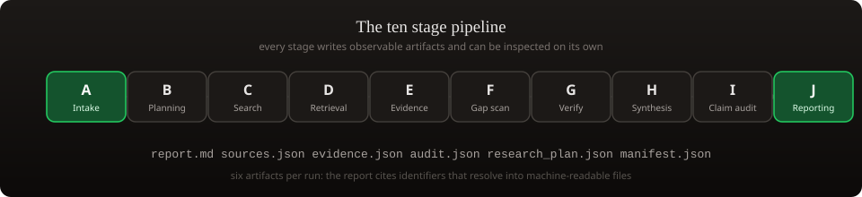

<div align="center">



[](LICENSE)
[](pyproject.toml)
[](pyproject.toml)
[](https://github.com/izynu/arguo/actions/workflows/ci.yml)
[](https://pypi.org/project/arguo/)
[](#authors)

**Research deeply. Verify independently. Show your evidence.**

Arguo is an open-source research intelligence toolkit. Every claim in a research report
can be traced back to a recorded source, and "the evidence was not sufficient" is an
explicit, honest verdict rather than a failure.

[Quickstart](#quickstart) · [What ships](#what-ships) · [The pipeline](#the-pipeline) ·
[Resource catalog](#resource-catalog) · [Documentation](#documentation) · [Contributing](CONTRIBUTING.md)


</div>

## Why Arguo

Research produced by language models is often fluent, weakly sourced, and impossible to
audit. Arguo builds the audit layer in: instead of producing a free-standing answer, every
run assembles a ledger of sources, evidence passages, and claims, then checks its own
citations before the report is written. Unknowns stay explicit, contradictions are surfaced
rather than smoothed over, and insufficient evidence is a valid final verdict.

- **Claims carry their evidence.** Every claim links to numbered evidence records and
  sources, with quotes, hashes, and provenance recorded, not reconstructed.
- **The pipeline is observable.** Ten stages, each with a status, timings, and warnings,
  recorded in a run manifest you can inspect.
- **Citations are audited.** A citation checker validates that every citation resolves and
  that each passage supports the claim it is attached to.
- **Offline is a first-class mode.** The full pipeline runs against labeled fixtures with no
  API keys and no network, so you can test, demo, and contribute without touching a provider.

## What ships

| Deliverable | What it is | Where |
| --- | --- | --- |
| Agent skills | Three portable SKILL.md packages that any compatible agent can load, following progressive disclosure: the evidence-first research method (20 references, 5 templates, 2 worked examples), the resource catalog curation method, and the citation audit method | [`skill/arguo/`](skill/arguo/), [`skill/arguo-curator/`](skill/arguo-curator/), [`skill/arguo-source-audit/`](skill/arguo-source-audit/) |
| Python research agent | A CLI and library (PyPI: `arguo`) that runs a 10-stage pipeline and writes six auditable artifacts; 167 offline tests | [`python/arguo/`](python/arguo/) |
| Resource catalog | 1,570 schema-validated records of real research resources across 50 categories and 82 regions, 369 with public APIs | [`data/`](data/) + [explorer](#resource-catalog) |
| Documentation site | This Next.js site: 81 documentation pages in 8 groups, a searchable catalog explorer, methodology, and eval reports | [`src/`](src/) |
| Evaluation harness | 56 structural benchmark cases in 8 files that measure citation validity, unsupported-claim rate, and source diversity | [`evals/`](evals/) |

## The pipeline

<div align="center">



</div>

Every run writes six artifacts into its output directory:

| Artifact | Contents |
| --- | --- |
| `research_plan.json` | Research question, subquestions, depth profile, date bounds, anticipated limitations |
| `sources.json` | Every source consulted, with URL, retrieval metadata, and quality assessment |
| `evidence.json` | The evidence ledger: claims, evidence records with quotes, and source links |
| `audit.json` | Citation audit results: issues found, contradictions, verdict counts |
| `report.md` | The final cited report with explicit uncertainty where evidence is thin |
| `manifest.json` | Run metadata: profile, providers, model calls, search rounds, stage timings |

## Quickstart

```bash
git clone https://github.com/izynu/arguo.git
cd arguo
python3 -m venv .venv && source .venv/bin/activate
pip install -e ".[dev]"
```

Check the environment, then run the full pipeline offline with fixture providers. No API
keys, no network, clearly labeled output:

```bash
arguo doctor
arguo research "Does urban tree cover reduce summer heat in cities?" --offline --output-dir runs/demo
```

<details>
<summary><strong>Running against real providers</strong></summary>

```bash
export ARGUO_SEARCH_PROVIDER=tavily
export TAVILY_API_KEY=your-key
export ARGUO_MODEL_PROVIDER=openai-compatible
export ARGUO_MODEL_BASE_URL=https://your-endpoint/chat/completions
export ARGUO_MODEL_API_KEY=your-key
export ARGUO_MODEL_NAME=your-model

arguo research "What changed in EU deforestation rules in 2024?" --since 2024-01-01 --profile standard
```

Every run writes its six artifacts locally. Nothing is published automatically. See
`.env.example` for the full variable list and `docs/getting-started/gs-configuration.md`
for profiles and budgets.

</details>

<details>
<summary><strong>CLI reference</strong></summary>

| Command | Purpose |
| --- | --- |
| `arguo research QUESTION` | Run the 10-stage research pipeline for one question |
| `arguo research ... --profile NAME` | Choose depth: `quick`, `standard`, `deep`, or `academic` |
| `arguo research ... --offline` | Use fixture providers; no network and no keys |
| `arguo research ... --since DATE --until DATE` | Restrict to sources published in a date window |
| `arguo research ... --max-sources N` | Cap sources per run |
| `arguo research ... --output-dir DIR` | Directory for run artifacts (default: `./runs`) |
| `arguo resources search QUERY` | Search the catalog by name, description, and tags |
| `arguo resources stats` | Print catalog summary statistics |
| `arguo doctor` | Check the environment, providers, catalog, and cache |
| `arguo cache clear` | Clear the fetch cache |
| `arguo eval run --offline` | Run the structural evaluation harness over `evals/cases` |

</details>

## Resource catalog

The catalog is the data backbone: real, individually documented records of government
statistics offices, academic indexes, archives, legal databases, earth observation portals,
and public APIs.

<div align="center">


**1,570 records · 50 categories · 82 regions · 369 with public APIs**

**150 live-checked and `verified` (2026-10-25) · 1,420 `documented`**


</div>

- Records live in `data/resources/*.jsonl` (19 authoring files, 1,594 raw records) and are
  merged with cross-file dedupe into `catalog/`.
- Every record carries explicit provenance, a license value of an SPDX id or the honest
  string `unknown`, and a verification status that only moves to `verified` after an actual
  live check by `scripts/check_links.py --live`.
- The site's resource explorer supports multi-word search with match highlighting, category,
  access, and region filters, bookmarking, JSON and CSV export of any filtered view, a
  command palette (Cmd+K or Ctrl+K), shareable filter URLs, related-record suggestions, and
  a generated statistics view. Dark theme is the default; the toggle is in the header.
- Contributing a record is simple and validated: see
  [`docs/resource-library/rl-contributing.md`](docs/resource-library/rl-contributing.md).

## Documentation

81 pages in 8 groups: getting started, core concepts, handbook, developer guide,
skill guide, resource library, quality and safety, and project. Start at
[`docs/getting-started/gs-introduction.md`](docs/getting-started/gs-introduction.md).

- `llms.txt` and `llms-full.txt` are generated at the site root for LLM-friendly reading.
- The site builds as a static export for GitHub Pages; deployment is documented in
  [`DEPLOYMENT.md`](DEPLOYMENT.md).

## Development

```bash
make install      # pip install -e ".[dev]"
make test         # 167 offline tests, no keys
make lint         # ruff over python, tests, scripts, evals, examples
make validate     # resource validators plus the skill validator
make catalog      # rebuild catalog/catalog.json, catalog.jsonl, stats.json
make docs-index   # regenerate the docs index, llms.txt, llms-full.txt
make site-stats   # regenerate public/data/site-stats.json from real contents
make check        # lint + test + validate
```

The style check (`tools/style_check.py`) enforces the project writing rules: no em dashes,
no en dashes, no emoji anywhere in authored copy.

## Honest limitations

> - Automated citation checks verify internal consistency and whether a cited passage
>   supports its claim. They cannot guarantee truth.
> - Offline mode runs against labeled fixtures. It demonstrates the pipeline; it does not
>   perform research.
> - 1,420 of 1,570 catalog records are `documented`, not `verified`. A record moves to
>   `verified` only after an actual live check.
> - For medical, legal, financial, or safety decisions, treat output as a starting point
>   for qualified human review, never a conclusion.

## Authors

<div align="center">

| [](https://github.com/izynu) | [](https://github.com/xhraddha) |
| :---: | :---: |
| [Zynu](https://github.com/izynu) | [Shraddha](https://github.com/xhraddha) |
| Lead maintainer · repository owner | Co-maintainer |
| [@izynu](https://github.com/izynu) | [@xhraddha](https://github.com/xhraddha) |

</div>

## Citing

See [`CITATION.cff`](CITATION.cff) for citation metadata, or
[`docs/project/pj-citation.md`](docs/project/pj-citation.md) for a BibTeX entry. Cite Arguo
for the mechanics it provided: retrieval, ledger structure, and auditing. The underlying
facts come from the sources recorded in the evidence ledger.

## License

Apache-2.0. See [LICENSE](LICENSE).

<div align="center">


**Arguo** is built and maintained by [Zynu](https://github.com/izynu) and
[Shraddha](https://github.com/xhraddha).

</div>
